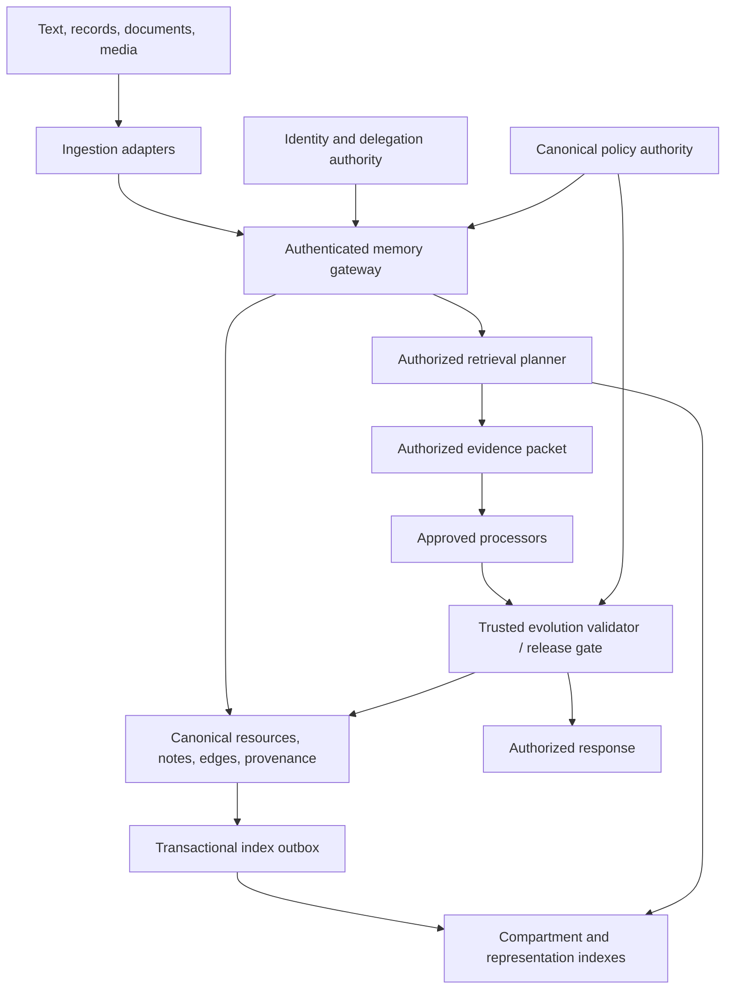

# Privacy-aware A-MEM: a reusable architecture

Status: architecture specification, reviewed on 20 October 2026. A standalone
single-service implementation and GateMem evaluator have since been added in
`agentic_memory/privacy/` and `evaluation/gatemem_medical/`; see the
[runtime runbook](evaluation/gatemem_medical/RUNBOOK.md) for executable scope,
validation, model configuration, and production deployment limits. The code
observations below describe the original implementation inspected before that addition.

Preserve A-MEM's flexible notes, semantic retrieval, directed links, and semantic
evolution. Put them behind a deterministic authorization and information-flow
boundary. Policies govern access; compartments organize search; provenance
governs derivation. None of these requires a medical entity model, a universal
owner, a tenant hierarchy, or ordered access levels.

This proposal supersedes the architectural recommendations in
[PRIVACY_DESIGN.md](PRIVACY_DESIGN.md), which is retained for comparison.
GateMem is a medical proof of concept and evaluation adapter, confined to
Section 11. Section 12 demonstrates reuse in software engineering.

## 1. Evidence and critical assessment

**Observed** below means statically inspected local code, not executed behavior.
**Proposed** means a new contract requiring implementation and verification.
**Unresolved** identifies a deployment or design choice that remains open.

Inspected A-MEM checkout: `ceffb86`, including the existing untracked proposal.
Auto Research checkout parent: `054df44`; findings concern the local files,
which may differ from that commit. `AR` below means
`/home/thaddus/Shared-Memory-for-Multi-Agents-Qwen-3.2-27b/Auto Research`.
No models, benchmarks, or runtime tests were run for this document.

### 1.1 A-MEM observations

| Observed behavior and evidence | Architectural consequence |
| --- | --- |
| [MemoryNote, memory_system.py:24](/home/thaddus/a-mem/agentic_memory/memory_system.py:24) contains content, keywords, context, tags, category, links, timestamps, usage, and evolution history. It contains no security policy or authenticated requester. | Retain the semantic shape; add a separate security envelope and protected provenance. Domain vocabulary is already optional data. |
| [Initialization, memory_system.py:108](/home/thaddus/a-mem/agentic_memory/memory_system.py:108) creates a dictionary and a retriever named `memories`, attempts `client.reset()`, then creates another retriever. [ChromaRetriever:55](/home/thaddus/a-mem/agentic_memory/retrievers.py:55) enables reset on an ordinary client. | This is not an existing durable, authorized memory service. Remove initialization-wide reset before shared use; establish canonical persistence and recovery. |
| [Retriever serialization:71](/home/thaddus/a-mem/agentic_memory/retrievers.py:71) converts lists/dictionaries to JSON strings and all other values to strings. [Search:93](/home/thaddus/a-mem/agentic_memory/retrievers.py:93) supplies query text and result count without an authorization constraint. | Adding a JSON `authorized_users` field alone does not implement access filtering. Define typed index projections and a tested candidate restriction interface. |
| [add_note:233](/home/thaddus/a-mem/agentic_memory/memory_system.py:233) constructs the note, calls `process_memory`, writes the dictionary and index. It does not invoke [analyze_content:159](/home/thaddus/a-mem/agentic_memory/memory_system.py:159). | Specify analysis as an explicit, governed processing step. Do not inherit the example's claim that addition always generates initial tags/context. |
| [read/update:346](/home/thaddus/a-mem/agentic_memory/memory_system.py:346) returns the live object and updates arbitrary existing attributes. [delete:398](/home/thaddus/a-mem/agentic_memory/memory_system.py:398) deletes a vector and dictionary entry. | Introduce immutable authorized views, write allowlists, action-specific checks, tombstones, and dependent-artifact handling. Adding security attributes to the current generic update loop would expose them to mutation. |
| [Related-memory helpers:288](/home/thaddus/a-mem/agentic_memory/memory_system.py:288), [search variants:415](/home/thaddus/a-mem/agentic_memory/memory_system.py:415), and [agentic expansion:554](/home/thaddus/a-mem/agentic_memory/memory_system.py:554) have no policy checks. Raw helpers format content; expansion reads linked objects. `_search` also makes a second call to the same retriever and treats its dictionary as a list of records. | Guard every entry point, including underscore methods and maintenance paths; do not assume the existing “hybrid” description is a sound implementation contract. |
| [process_memory:603](/home/thaddus/a-mem/agentic_memory/memory_system.py:603) sends the new note and up to five neighbors' content/context/keywords/tags to one model call. [Response application:676](/home/thaddus/a-mem/agentic_memory/memory_system.py:676) extends links and rewrites neighbor tags/context. | Every output of that call depends conservatively on the whole input, not merely the named target. Private context can contaminate broadly readable metadata. |
| [find_related_memories:302](/home/thaddus/a-mem/agentic_memory/memory_system.py:302) returns search positions rather than returned IDs; [neighbor updates:687](/home/thaddus/a-mem/agentic_memory/memory_system.py:687) applies positions to dictionary insertion order. Suggested links are not checked against the retrieved IDs. | A neighbor update can hit the wrong record. Require stable IDs, revisions, target authorization, and an exact proposed-target allowlist. |
| Neighbor evolution changes dictionary objects without immediately updating their index records. [Consolidation:266](/home/thaddus/a-mem/agentic_memory/memory_system.py:266) opens the same named collection and calls `add` for every note; its “reset” comment is not a reset call. Embeddings are generated from note content, not a concatenation of all semantic fields. | Treat index state as potentially stale; do not claim current tags/context are always embedded or synchronized. Use versioned rebuilds and an outbox instead of relying on consolidation. |
| [Persistent and copied retrievers:147](/home/thaddus/a-mem/agentic_memory/retrievers.py:147) exist separately. [Collection cloning:18](/home/thaddus/a-mem/agentic_memory/retrievers.py:18) copies documents, metadata, and embeddings wholesale. [LLM backends:13](/home/thaddus/a-mem/agentic_memory/llm_controller.py:13) select remote or Ollama processing without policy checks. | Persistence, cloning, temporary files, and processor selection are additional security surfaces. “Local backend” is a processing choice, not authorization. |

Existing [memory tests](/home/thaddus/a-mem/tests/test_memory_system.py:5)
exercise CRUD, links, and non-null evolution fields. They do not establish a
privacy boundary. Dependency declarations such as
[pyproject.toml:18](/home/thaddus/a-mem/pyproject.toml:18) use lower bounds;
backend filtering behavior must be pinned and tested during implementation.
This proposal makes no claim about an installed Chroma version's filter semantics.

### 1.2 Auto Research: useful patterns and limits

| Observed reference | Reuse and qualification |
| --- | --- |
| [AR/online/interfaces.py:7](</home/thaddus/Shared-Memory-for-Multi-Agents-Qwen-3.2-27b/Auto Research/online/interfaces.py:7>) defines generic stream datasets; inferred domains return no policy. Extensions preserve earlier turns/questions. | Reuse explicit adapter-supplied policy, append identity, and source preservation. The interface assumes authenticated envelopes; it does not authenticate callers itself. |
| [AR/templates/memory_system/schema.sql:6](</home/thaddus/Shared-Memory-for-Multi-Agents-Qwen-3.2-27b/Auto Research/templates/memory_system/schema.sql:6>) separates principals, observations, relationships, memories, permissions, semantic links, tombstones, and typed projections. | Reuse source-backed canonical records and extensible projections. It still centers permission records on `resource_owner_id`; relationships lack the standalone edge-policy envelope proposed here. |
| [AR/templates/memory_system/store.py:215](</home/thaddus/Shared-Memory-for-Multi-Agents-Qwen-3.2-27b/Auto Research/templates/memory_system/store.py:215>) preserves raw payloads/hashes. Structured facts use exact source paths, with bounded projection sizes. | Reuse raw-versus-derived separation, idempotence, and source locators. Generalize beyond turn text and JSON leaves to modality-specific adapters. |
| [AR/templates/memory_system/policy.py:62](</home/thaddus/Shared-Memory-for-Multi-Agents-Qwen-3.2-27b/Auto Research/templates/memory_system/policy.py:62>) checks configured isolation, lifecycle, revocations, and denies before allows; defaults to denial. | Reuse deterministic decisions. Do not copy its implicit owner actions at line 85. Its generic grant matcher does not itself evaluate grant validity intervals; a complete authority contract must do so. |
| [AR/online/authority.py:9](</home/thaddus/Shared-Memory-for-Multi-Agents-Qwen-3.2-27b/Auto Research/online/authority.py:9>) reconstructs authority from preserved observations and trusted headers, outside candidate permissions. Source-budget exhaustion fails closed. | Reuse independence from adaptive state. Production authority must additionally verify issuer, identity, scope, and source authenticity. Text interpretation remains a bounded trusted adapter, not universal authority. |
| [AR/templates/memory_system/agent.py:263](</home/thaddus/Shared-Memory-for-Multi-Agents-Qwen-3.2-27b/Auto Research/templates/memory_system/agent.py:263>) infers relationship endpoints and an owner using ID frequencies. [store.py:697](</home/thaddus/Shared-Memory-for-Multi-Agents-Qwen-3.2-27b/Auto Research/templates/memory_system/store.py:697>) permits matching owner IDs directly and classifies resources from semantic concepts. | Do not use frequency, semantic classification, or ownership inference to establish authority. Subject/entity resolution may propose associations; authoritative resource binding must come from the source/control plane. |
| [AR/store.py:947](</home/thaddus/Shared-Memory-for-Multi-Agents-Qwen-3.2-27b/Auto Research/templates/memory_system/store.py:947>) interprets permission phrases; relationship metadata can yield grants. Its optional interpreter path at line 1036 accepts permission suggestions when text contains an authorization cue. `grant_permission` requires a source observation, not an independent issuer check. | A source citation or authorization-sounding phrase is insufficient proof of grant authority. Keep such outputs as proposals unless a separately trusted control adapter validates the complete grant. The online independent audit provides a further boundary; the template alone should not be presented as equivalent. |
| [AR/online/evidence.py:82](</home/thaddus/Shared-Memory-for-Multi-Agents-Qwen-3.2-27b/Auto Research/online/evidence.py:82>) independently checks source support, current retained controls, scope, time, and lifecycle on a read-only copy. [backend.py:216](</home/thaddus/Shared-Memory-for-Multi-Agents-Qwen-3.2-27b/Auto Research/online/backend.py:216>) validates selected evidence and claims before rendering. | Reuse an independent evidence/release boundary. Exact excerpts and typed projections are good deterministic proofs; they do not validate arbitrary generated summaries. Add full-input lineage and live-policy release synchronization. |
| [AR/online/dynamic_sql.py:31](</home/thaddus/Shared-Memory-for-Multi-Agents-Qwen-3.2-27b/Auto Research/online/dynamic_sql.py:31>) gives generated SQL an ephemeral authorized projection, not the source database. Specialized schema names and edge endpoints are filtered too. | Reuse query planning over authorized data. The template's ordinary retrieval scores candidates before its authorization loop ([store.py:486](</home/thaddus/Shared-Memory-for-Multi-Agents-Qwen-3.2-27b/Auto Research/templates/memory_system/store.py:486>)); it is not evidence of authorization-before-ranking. |
| [AR/online/runner.py:1460](</home/thaddus/Shared-Memory-for-Multi-Agents-Qwen-3.2-27b/Auto Research/online/runner.py:1460>) stages exact deltas and validates ingestion membership. [Promotion:3573](</home/thaddus/Shared-Memory-for-Multi-Agents-Qwen-3.2-27b/Auto Research/online/runner.py:3573>) commits version/image state transactionally. [recovery.py:13](</home/thaddus/Shared-Memory-for-Multi-Agents-Qwen-3.2-27b/Auto Research/online/recovery.py:13>) preserves negative controls through failed parsing and rebuilds. | Reuse explicit gaps, atomic promotion, idempotent recovery, and current restrictions over historical replay. Do not conflate a scheduling cursor with successful ingestion. Keep control ingestion independent of semantic-parser success. |
| [AR/online/validation.py:37](</home/thaddus/Shared-Memory-for-Multi-Agents-Qwen-3.2-27b/Auto Research/online/validation.py:37>) sandboxes candidate work and fails if the sandbox is missing. Preservation checks start at line 152. [specialized.py:14](</home/thaddus/Shared-Memory-for-Multi-Agents-Qwen-3.2-27b/Auto Research/templates/memory_system/specialized.py:14>) requires versioned projections tied to canonical facts. | Reuse isolated candidates, protected state checks, typed views, migration/replay gates, and rollback. File isolation alone does not establish approved network egress or model processing. |
| [AR/online/measurement.py:12](</home/thaddus/Shared-Memory-for-Multi-Agents-Qwen-3.2-27b/Auto Research/online/measurement.py:12>) measures a separate dataset under pinned code. [metrics.py:36](</home/thaddus/Shared-Memory-for-Multi-Agents-Qwen-3.2-27b/Auto Research/online/metrics.py:36>) keeps privacy/deletion regressions separate from utility gains. | Reuse first-attempt/repaired/held-out separation and explicit unknown outcomes. Regression replay is not independent generalization evidence; a combined score cannot excuse a security failure. |

The local [online revision document](</home/thaddus/Shared-Memory-for-Multi-Agents-Qwen-3.2-27b/Auto Research/docs/online-revision-20261018.md:65>)
describes these recovery, domain-separation, and measurement intentions. Some
medical coupling remains in integration: [backend.py:132](</home/thaddus/Shared-Memory-for-Multi-Agents-Qwen-3.2-27b/Auto Research/online/backend.py:132>)
imports a medical evaluator for live rendering. Therefore reuse contracts and
selected mechanisms, rather than declaring the whole workflow domain independent.

### 1.3 Assessment of the initial proposal

Keep its policy references, protected directed edges, canonical-store idea,
quarantine, live rechecks, restricted overlays, and full-prompt intersection rule.
Its principal weakness is where examples become architectural defaults:

| Initial assumption | Revision |
| --- | --- |
| The main note schema uses a hospital tenant, patient owner, and medication policy. | Use resource IDs and policy bindings. Subjects are optional descriptive associations; no subject or owner automatically controls a resource. A deployment can configure administrative namespaces without imposing a universal tenant/organization model. |
| Public directory plus one collection per patient is the initial storage strategy. | Use configurable, opaque compartments as stable routing units. They can represent a workspace, source agreement, project, explicit sharing boundary, or another access scope. Patient routing is only one adapter choice. |
| A common text embedding space is assumed throughout the storage discussion. | Reuse an approved model where suitable; permit multiple text, image, audio, and structured retrieval projections. Index separation, model choice, and physical isolation are independent decisions. |
| The first automatic-link rule only handles equivalent private scopes or private-to-public links. | Enforce edge policies and endpoint checks generically. Cross-compartment private links are representable immediately; conservative automation may require a validated policy conjunction. No total hierarchy or graph acyclicity is required. |
| Security acceptance fixtures are clinical. | Make core tests opaque and domain independent; keep GateMem and clinical fixtures in adapter evaluation. |
| Trusted local processing and revalidation are described without a concrete release race contract. | Approve processors per policy and operation, and synchronize buffered release with current authority. Local processing can be the prototype default but is not the definition of safety. |

These changes generalize the design rather than removing its useful safeguards.

## 2. Reusable core, configuration, and adapters



| Layer | Owns | Must not do |
| --- | --- | --- |
| Reusable trusted core | Resource/note/edge identity, policy decision interface, action gates, compartment routing, protected provenance, dependency conjunctions, transactions, lifecycle, release synchronization, processor approval checks. | Infer access from a topic, learned role, relationship name, or model confidence. |
| Adaptable semantic components | Extraction proposals, semantic tags, link proposals, query planning/ranking over permitted inputs, optional typed projections and summaries. | Write grants, authoritative attributes, compartment bindings, or bypass the gateway. |
| Trusted deployment/domain configuration | Identity issuers, group authorities, scoped policy rules, accepted resource attributes, role/entity vocabularies, approved predicates, routing rules, processor registry, retention, evaluation setup. | Give source text or an adaptive candidate authority to rewrite this configuration. |
| Data adapters | Connectors, authentication mapping, MIME-specific parsing, source locators, field-policy mapping, provenance, idempotence and replacement semantics. A separate control adapter validates policy events. | Treat arbitrary document metadata as a signed policy or silently downgrade restrictions after parsing. |
| Evaluation adapters | GateMem format/actions/scorers; independently specified nonmedical fixtures and utility oracles. | Feed hidden expected answers or benchmark-only policy hints to production ingestion or retrieval. |

The core can use a policy engine configured with roles, attributes, groups, and
authoritative relationship facts. These are mechanisms, not built-in domain
roles. Deployments may use overlapping groups and incomparable policies.
There is no numeric `access_level` lattice or automatic “administrator sees all”
rule. An administrative action is a separately authorized action.

## 3. Security contract and authoritative state

### 3.1 Request identity and decisions

The gateway receives a verified `RequestContext`: authenticated executing agent,
delegating principal and delegation chain (when acting for someone), intended
action, trusted clock, verified attributes, purpose where enforced, recipient,
request ID, and identity/authority revisions. Caller text cannot set these fields.
Public requests map to an explicit low-privilege public principal; missing
authentication context is not an implicit public or superuser mode.

For a delegated request, effective permission is the conjunction of the agent's
own allowed scope, each delegation restriction, and the delegating user's current
permission on the action/resource. Further delegation only attenuates scope,
actions, expiry, and permitted recipients. A background task uses an explicit
service grant; it cannot silently substitute its service identity for a user.
Multi-agent handoff checks the receiving agent and user again, and transfers a
protected evidence reference rather than a globally readable transcript.

The policy authority evaluates resource/observation/edge actions using verified
bindings, current group membership, issued scoped grants, revocations, trusted
time, and configured rules. Resource lifecycle and configured isolation
constraints precede grants. Applicable denials override allows; an expired,
revoked, invalid, or out-of-scope grant cannot authorize anything. Other independent
valid grants can still authorize access unless a current denial blocks it.
Unknown identities, policy errors, malformed scopes/times, missing bindings,
unavailable current authority, and unresolved dependencies fail closed.

Separate `discover/search`, `read`, `derive/process`, `write`, `link`, `delete`,
`export`, and `manage_policy` actions; exact names are configuration-facing API
values. Search that will return bodies requires read permission as well.
Read does not imply write, onward export, processing by any provider, or granting
someone else access. The core provides no automatic privilege based on ownership.

### 3.2 Direct lists versus policy references

| Choice | Advantages | Costs and constraints |
| --- | --- | --- |
| Direct `authorized_principal_ids` on every note | Easy to inspect; small static sharing sets are straightforward. | Duplicated membership and updates; weak expression of expiry, scoped actions, delegation and purpose. Stale copies and indexes are dangerous. The list still needs an authenticated issuer, authoritative storage, and live revocation. |
| Policy reference plus canonical grants/groups | Central revocation, reusable rules, overlapping scopes, auditable delegation, compact note envelope. | Requires a reachable, versioned decision service and careful cache invalidation. Policy evaluation and filter compilation must agree. |

**Recommendation:** policy references as the normal note contract. An explicit
ACL is a simple policy document supported by the same authority, not a separate
bypass. Store the authoritative policy outside vector metadata. Policy bodies,
membership lists, denial reasons, and policy IDs can themselves be sensitive.

A single logical authority may federate several issuers, but trusted configuration
defines which issuer controls which attributes and resource scopes. Policy
events require issuer authorization, replay protection, validity, and audit
provenance. Semantic relationship records never double as authoritative group
membership, assignment, or delegation records. An authoritative relationship
fact may feed configured authorization rules only through this control plane.

## 4. Illustrative generic schemas

These examples describe contracts rather than a final database migration.
Opaque IDs below convey no access rights. Canonical records also have immutable
revisions, creation/update times, and validated foreign keys.

### 4.1 Observation envelope and note

```json
{
  "observation_id": "obs_7",
  "resource_id": "res_7",
  "source": {
    "connector_id": "connector_2",
    "external_id": "external_19",
    "source_revision": "v3",
    "media_type": "application/json",
    "payload_ref": "blob_7",
    "integrity_digest": "sha256:..."
  },
  "ingestion": {
    "adapter_id": "records-v1",
    "idempotency_key": "batch_4:item_19:v3",
    "authenticated_issuer": "issuer_2",
    "received_at": "2026-10-20T05:00:00Z",
    "event_time": "2026-10-19T10:00:00Z"
  },
  "security": {
    "policy_binding_id": "binding_7",
    "compartment_id": "comp_4",
    "processing_profile_ref": "processors_2"
  },
  "state": "active"
}
```

```json
{
  "memory_id": "mem_9",
  "resource_id": "res_9",
  "revision": 3,
  "content": {"text": "A source-backed observation.", "structured_ref": "projection_3"},
  "semantic": {
    "keywords": ["topic-x"],
    "tags": ["observation"],
    "context": "Optional semantic context",
    "category": "configurable-category"
  },
  "source_refs": [
    {"observation_id": "obs_7", "source_revision": "v3", "locator": {"json_pointer": "/items/0/value"}}
  ],
  "security": {
    "policy_binding_id": "binding_9",
    "compartment_id": "comp_4",
    "dependency_set_id": "deps_9",
    "processing_profile_ref": "processors_2"
  },
  "representation_refs": ["repr_9_text"],
  "provenance_ref": "run_9",
  "state": "active"
}
```

`resource_id` supplies a generic authorization target for a source, note, edge,
blob, or derived artifact. Optional subject associations can be many-to-many;
they do not establish ownership or authorization. Semantic category/tag changes
cannot change a resource's authoritative attributes. Security envelope mutation
uses a separate authorized operation, never arbitrary note `kwargs`.

### 4.2 Policy, grants, and bindings

```json
{
  "policy_id": "policy_4",
  "authority_id": "authority_1",
  "revision": 12,
  "default_effect": "deny",
  "combining_algorithm": "deny_overrides",
  "grants": [{
    "grant_id": "grant_21",
    "effect": "allow",
    "subject": {"kind": "group", "id": "group_5"},
    "actions": ["search", "read", "derive"],
    "resource_selector": {"resource_set_id": "set_4"},
    "conditions": {"purpose_in": ["purpose_1"]},
    "valid_from": "2026-10-20T00:00:00Z",
    "valid_until": "2026-10-21T00:00:00Z",
    "issuer_id": "issuer_1",
    "authority_event_id": "event_21",
    "parent_grant_id": null,
    "status": "active"
  }],
  "processing_constraints_ref": "processors_2"
}
```

```json
{
  "binding_id": "binding_9",
  "resource_id": "res_9",
  "base_policy_refs": ["policy_4"],
  "derivation_policy_ref": "flow_9",
  "binding_revision": 3,
  "observed_policy_revisions": {"policy_4": 12}
}
```

Missing grant subject, action, or selector is invalid, never a wildcard.
Explicit public access is a deliberate policy subject, not an absent list.
Group membership and resource-set membership are versioned authoritative facts.
Their changes participate in revocation checks. Purpose is useful only if its
assertion and enforcement are trustworthy; caller-supplied purpose is not proof.

`observed_policy_revisions` records what a past decision saw. Live decisions
resolve current policy heads and resource bindings; pinning revision 12 must not
keep its expired or revoked privileges alive. Historical policy versions support
audit, not a historical-access escape hatch.

### 4.3 Compartment, representation, relationship, derivation

```json
{
  "compartment_id": "comp_4",
  "routing_policy_ref": "routing_2",
  "index_bindings": [{"representation_space_id": "text-v2", "collection_ref": "idx_8"}],
  "deployment_boundary_ref": "boundary_1",
  "state": "active"
}
```

```json
{
  "representation_id": "repr_9_text",
  "memory_id": "mem_9",
  "memory_revision": 3,
  "input_artifact_refs": ["mem_9:3.content"],
  "space_id": "text-v2",
  "processor_version": "embedder-version-digest",
  "compartment_id": "comp_4",
  "security_binding_ref": "binding_9",
  "dependency_set_id": "deps_repr_9",
  "index_generation": 6
}
```

```json
{
  "edge_id": "edge_8",
  "resource_id": "res_edge_8",
  "revision": 1,
  "from_memory_id": "mem_9",
  "to_memory_id": "mem_public_2",
  "predicate": "references",
  "attributes": {},
  "security": {"policy_binding_id": "binding_edge_8", "compartment_id": "comp_4", "dependency_set_id": "deps_edge_8"},
  "provenance_ref": "run_9",
  "state": "active"
}
```

```json
{
  "derivation_id": "run_9",
  "operation": "semantic_enrichment",
  "processor_ref": "approved-processor-version",
  "request_context_ref": "audit_request_9",
  "input_manifest": [
    {"artifact_id": "obs_7", "revision": "v3", "selector": "/items/0/value"},
    {"artifact_id": "mem_public_2", "revision": 2, "selector": "entire-authorized-view"}
  ],
  "inherited_context_refs": [],
  "output_artifact_refs": ["mem_9:3", "edge_8:1"],
  "flow_policy": {"all_of_live_input_bindings": ["binding_7", "binding_public_2"]},
  "provenance_digest": "sha256:..."
}
```

The manifest includes the actual consumed views and indirect inputs: system
instructions carrying private examples, query text, histories, tool results,
overlays, ranking features, and persistent processor context where applicable.
It is generated by trusted orchestration, not model-reported citations. Store
protected references/digests instead of retaining every raw prompt by default.
For multi-output calls every output initially inherits the whole input manifest.
Separate dependency records support many parents and transitive lineage; a
single `derived_from_id` is insufficient. Dependency metadata is itself protected.

## 5. Storage and searchable compartments

### 5.1 Options

| Design | Benefits | Costs / security constraints |
| --- | --- | --- |
| Shared index with authorization filtering | Few collections; efficient shared operation; flexible overlap. | Requires verified pre-ranking filters and current canonical rechecks. Post-filtering global top-k harms recall and can make private population affect visible output. Shared statistics and ANN structure can introduce further interference. |
| Separate collections/compartments | Clear routing; limits accidentally searched data; supports independent rebuilds and approved processor routes. | Collection fan-out and many small indexes cost resources. Compartment membership is not complete authorization when policies inside it vary. |
| Separate services/databases/credentials/keys | Can establish stronger operational boundaries. | More deployment and cross-boundary orchestration cost. A process holding every key still has broad access. Collections alone provide none of these physical guarantees. |

**Recommendation:** a canonical relational store plus protected object storage,
with rebuildable search indexes routed by configurable stable compartments and
representation spaces. Start with SQLite for a single-service prototype;
choose a transactional service database when concurrency or distributed policy
authority requires it. Chroma can remain one retrieval backend behind an interface.

A compartment is an opaque routing unit, not an ownership claim or a fixed access
level. Membership changes normally update policies rather than move embeddings.
Do not create an index per reader combination or role. A note has one canonical
home; optional replicas all reference that identity, binding, and revision.
Discovery of compartments and routing statistics is guarded too. Routing resolves
compartments containing potentially readable resources; it must not require a
blanket right to every note inside them.

Within each selected compartment, derive an authoritative allowed-ID set or
equivalent validated predicate **before semantic ranking**. For the first small
implementation, a trusted worker can materialize permitted representations and
rank them exactly. This is a correctness-first fallback if the chosen backend
cannot express an exact filter. At scale, test an authorization-aware backend or
versioned security projections against the same decision oracle. Never broaden
search silently or hand an unfiltered index to an untrusted planner.

Index rows need only routing IDs, canonical record/revision references, processing
space/version, and derived security hints. Avoid duplicating full bodies into
metadata. Stored text snippets, terms, vectors, ANN graphs, and statistics inherit
the source restrictions; embeddings are not anonymization.

### 5.2 Three independent decisions

1. **Index separation:** which candidates can be searched together.
2. **Representation choice:** which approved tokenizer, embedding model, exact
   filter, lexical index, or typed query projection suits a modality/task.
3. **Deployment isolation:** which processes, credentials, devices, object stores,
   administrators, network routes, and encryption domains can access the bytes.

Using the same fixed text embedder in two compartments does not join their
audiences. Different models do not establish isolation. Distances across different
embedding spaces are not directly comparable; fuse authorized rank lists or use
an approved reranker over authorized views. Track model/version changes and
rebuild representations explicitly.

For strict public-result independence, public search must use a public-only index
generation, public-only corpus statistics, and a query context permitted for that
processing route. Hidden private insertion, links, and usage must not modify
public ranking features. Within mixed-policy compartments, strict independence
may require exact ranking over the authorized projection; ANN post-filtering
alone does not establish it. Cross-request timing and shared resource contention
remain a separate deployment limitation.

## 6. Ingestion across data types

```text
verified source envelope + declared resource restrictions
  -> validate source identity, ingest action, policy binding and processor route
  -> preserve protected source revision and idempotency digest
  -> adapter parses into bounded, source-addressable observations/views
  -> approved extraction proposes notes, metadata and semantic relationships
  -> trusted validator assigns inherited policies and records full dependencies
  -> canonical transaction commits artifacts + provenance + index-outbox events
  -> index worker publishes current approved representations
```

| Input | Adapter output and source locator | Processing considerations |
| --- | --- | --- |
| Text/conversation | Notes tied to immutable message IDs, revisions and spans. | Chunking, language and quote boundaries; conversation history is also input. |
| Structured records | Typed values and deterministic projections tied to record version and JSON pointer/table field. | Exact/range/relational retrieval may be better than embedding serialized JSON. Preserve units, nulls and replacement semantics in adapters. |
| Documents | Source blob plus page/section/byte or bounding-box locators; layout-aware chunks. | Approved parsers, OCR, tables and captions; titles and file names can be restricted. |
| Images/audio/video/other modalities | Protected original plus region/time locators, optional transcripts/captions/features. | Modality-specific processors and retrieval spaces; a transcript is a derived artifact with its own provenance. Unsupported formats stay protected and explicitly unindexed. |

Restrictions apply **before** parsing, OCR, embeddings or model calls. Parsing an
untrusted file occurs in a bounded environment; embedded instructions and claimed
ACLs are content, not control events. A failed parser leaves a protected source
and an explicit ingestion gap, not a public fallback or a success cursor.
An idempotency key reused with different bytes/restrictions is rejected.

An entire mixed-policy input conservatively has the conjunction of its input
restrictions. Finer views are allowed only when a trusted source/field policy and
a deterministic projection establish their bounds before model processing.
If a model sees the whole document, all its extracted chunks inherit that whole
input's restrictions even if a chunk appears harmless. A source citation to a
single field does not erase the rest of the prompt's influence.

Security-control events use a separate authenticated path that remains available
when ordinary parsing fails. A candidate may propose a new parser or schema, but
it cannot approve a new policy issuer or reinterpret a document as a grant.
Changes to a connector's upstream access must invalidate cached authority or
block release until synchronized; webhook delivery alone is not an instantaneous
revocation guarantee.

## 7. Retrieval and every disclosure path

```text
authenticate agent + delegating principal + recipient
  -> resolve current authority/delegation and permitted processing route
  -> resolve candidate compartments and authorized canonical IDs/views
  -> search/rank only eligible representations
  -> fetch current canonical revisions; reject stale/deleted/misrouted hits
  -> authorize edge discovery and each target independently
  -> construct protected evidence packet with full dependency/decision revisions
  -> approved answer generation, if requested
  -> current-policy/lifecycle/recipient release barrier
  -> return immutable authorized views or a buffered answer
```

Apply the same gateway to direct IDs, all search variants, raw helpers, graph
traversal, preview, history, batch reads, counts, export, copy/clone, consolidation,
index rebuild, debugging, and maintenance. Internal workers receive explicit
capabilities scoped to their task; their privileges do not pass to callers.
No live Python object, raw dictionary, vector connection, or filesystem path is
exposed to ordinary agents. An underscore method is not a security boundary.

At each canonical fetch check identity, record and binding revisions, route,
lifecycle, source dependencies, and current policy. Treat index security fields
as hints. A stale index allow is rejected; stale denial may reduce recall and
should trigger repair, never a permissive fallback. Bound retries and fail closed
if authoritative membership cannot be resolved.

Caches include agent/delegation scope, recipient, query restriction, authority and
membership revisions, representation version, and evidence lineage. Invalidation
helps latency; live dependency checks remain required. Reusing a cache entry
across different identities requires a fresh authorization proof, not a shared
role string. Retained model sessions, conversation summaries, query rewrites and
retrieval plans are derived artifacts too. Rebuild authorized context after a
revocation rather than appending a new instruction to an old private transcript.

Exports require both sender export authority and recipient authorization for the
actual output. Protected managed exports retain dependency checks. Once bytes
are sent to an unmanaged recipient or downloaded, the service cannot recall them;
future revocation governs future service releases, not human memory or external
copies. Deployment policy decides whether unmanaged export is permitted.

Public APIs return an indistinguishable unavailable response for nonexistent and
inaccessible IDs. They do not expose denied counts, hidden collection names,
incoming degrees, raw scores over hidden candidates, private debug traces, or
different existence-specific refusal reasons. Authorized pagination/counts cover
only the authorized projection. Keep detailed denial/audit diagnostics protected.
GateMem's scoring-oriented distinction between refusal and no-memory belongs in
its evaluation adapter, not an automatic public existence oracle.

### Policy changes during requests

The first version buffers generated text and releases no token before the final
gate. The canonical authority serializes the release decision with policy,
membership, delegation, binding and tombstone changes, for example through a
shared revision/transaction barrier. Release has a defined linearization point:
a revocation committed before it blocks that release. The gate checks **all**
consumed inputs, not only cited records. If any input becomes unauthorized,
discard the generated artifact and restart from a fresh authorized context or
withhold it. Removing citations or filtering sentences cannot remove latent
influence reliably.

In a distributed deployment the authority must supply an equivalent consistent
release/fencing protocol. Re-reading a version and then sending later is still
a race. Physical byte delivery cannot be undone after a successful release;
streaming needs a separately specified per-chunk contract and is deferred.

## 8. Protected directed relationships

An edge is a first-class protected resource containing endpoints, predicate,
attributes, policy, provenance, revisions and lifecycle. Its existence and type
can be sensitive even when both endpoints are public. For automatic edges, the
edge policy includes the conjunction of all evidence used plus restrictions on
the endpoint identities it discloses. The initial API reveals an edge only when
the requester may read the edge and both endpoint identities; target content
still requires its own read decision. Opaque target-reference APIs, if needed,
would require a separately specified discover permission.

A restricted note may point to an approved public note. The edge resides in a
restricted edge store/compartment; the public target contains no private edge ID,
backlink, incoming count, evolved summary, popularity increment, or public
timestamp change caused by that edge. Public responses remain identical whether
that private relationship exists or not. Public link rendering uses only edges
authorized for that public request.

Following a visible edge never grants access. Traversal checks source visibility,
edge policy/provenance, endpoint identity, and target read permission at every
step, under the current request. Reverse lookup, if offered, searches protected
edges under the same constraints; it does not mutate the target's public record.
Cycles are allowed; visited sets and traversal budgets prevent loops.

Edges across two incomparable restricted compartments are supported by an edge
policy conjunction stored in a suitable restricted routing scope. There is no
need to move or merge the endpoints. An authorized link creator needs `link`
authority and access to the evidence; the model can only suggest links among
the verified target IDs it was shown. Similarity is not permission evidence.

Authoritative policy relationships such as group membership or delegation live
in the control plane. A semantic `member_of` edge cannot become one by using the
same predicate string. Trust type and issuer are structured authority fields,
not learned tags.

## 9. Memory evolution and information flow

For every automatic derived artifact `d`, request context `c`, and time `t`:

```text
Audience(d, c, t) ⊆ intersection(Audience(i, c, t) for every consumed input i)
```

An audience is a set of principals permitted under current policies and context,
not a numeric level or a cached user list. Enforce this as a live conjunction of
input restrictions and transitive dependencies, plus the output's own policy.
Input processing constraints also compose: a processor/operation must be approved
for every input. An empty audience or empty set of approved processors means
the proposed operation/output cannot be used on that route.

Dependencies retain exact consumed versions and selectors while linking to live
policy bindings and tombstones. Record applicable issuance restrictions as a
ceiling as well as current authority, so a later source-policy broadening does
not automatically publish existing derivatives. Any widening of a derivative
requires a new authorized operation with fresh validation. Revocation, expiry,
membership removal, or an explicit narrowing of any dependency restricts the
derivative immediately at read/release; asynchronous descendant cleanup is
additional defense. A denied user may retain another independently valid grant,
so recompute decisions rather than assuming every revocation destroys all outputs
for all principals.

The ceiling preserves the issued rule structure and resource/issuer scope; it
does not freeze a list of group members. Group membership still follows its
designated authority, so an authorized membership change can affect resources
governed by that group. Replacing a source policy with a public rule cannot
silently replace the derivative's issuance ceiling or detach its other parents.

Use a dependency DAG over immutable artifact **revisions** even though semantic
relationships may contain cycles. Evolving note revision 3 can depend on its
revision 2; it must not recursively depend on its own latest revision. Keep the
consumed binding version/flow expression and references to current authority
heads separately. Reject cyclic provenance, missing ancestors and incomplete
lineage. This also prevents a security-policy lookup from accidentally following
an unbounded semantic graph.

The rule covers content, contexts, keywords, tags, inferred entity labels,
summaries, edges, overlays, embeddings, learned synonym maps, query expansion,
ranking statistics and caches. A model's statement that it ignored an input is
not a dependency proof. A private example in a system prompt counts even if it
does not appear in a citation. For embeddings and ranking, track the actual input
fields and any adaptive shared features, not just the nominal note ID.

Queries, feedback, and request histories enter as transient protected resources
with bindings assigned by the authenticated application. Their audience is not
implicitly public because they are absent from the note database. A response to
that requester can use them; a persistent shared-note update must also satisfy
their restrictions, usually requiring a separate call or a private overlay.
Bindings and lineage for a retained output outlive transient prompt bytes.

### Safe replacement for neighbor mutation

```text
new protected note revision
  -> gateway retrieves an authorized, processing-compatible neighbor set
  -> planner determines allowed output scopes before model invocation
  -> orchestrator seals the full input manifest; model receives permitted views
     with stable IDs/revisions
  -> model returns semantic proposals only
  -> validator checks schema, exact target IDs, target write/link authority,
     revision conflicts, live dependency conjunction and processor approval
  -> commit new revisions / restricted overlays / protected edges atomically
  -> enqueue only matching derived representations for indexing
```

Use policy-homogeneous calls for direct shared-note mutation initially. Treat
“homogeneous” as verified equivalent restrictions including purposes and
processing constraints, not matching tags or equal current reader lists. When
equivalence or implication cannot be established, choose a restricted derivative
or overlay; fail closed rather than guessing about policy subsumption.

If a call sees private information and a public note, every proposal from that
call inherits the private conjunction. Updating that public note, its context,
tags, index metadata or embedding is rejected. Instead create a **restricted
overlay** with `base_memory_id`, base revision, its own content, binding and
lineage. Public retrieval sees only the base. Authorized retrieval can assemble
base plus overlay into a request-specific protected view without persisting the
merge into the public note. The merged view and its embedding, if retained,
inherit both policies. Overlay existence/counts remain private.

An independent public-only call can evolve the public note from public evidence.
It must not inherit private chat history, cached hidden state, reranking features,
or suggestions from the mixed call. Automatic “anonymization” never broadens an
audience. The core includes no model-driven declassification path. Any explicit
publication exception would require separately specified authority and a separate
security contract; it is outside the automatic derivation rule proposed here.

Do not adapt shared model weights, global synonym dictionaries, public retrieval
statistics, or shared vector quantizers from restricted notes as ordinary memory
evolution. Such artifacts are also derived data and would require their own
information-flow, isolation, retention and deletion design. Preserve A-MEM's
adaptability through governed notes, projections, links and scoped indexes.

### Controlled adaptation beyond individual notes

Borrow the online workflow's staged candidate process: versioned proposals with
rationale and expected benefit; isolated build/migration/reingestion; protected
state and provenance validation; paired targeted replay; broad security/utility
regression checks; atomic promotion of compatible code, schema and index versions;
rollback that reapplies current restrictions and retains later accepted sources.
Adaptable components never obtain write access to policy authority, identity
mapping, the release gate, or the dependency enforcement implementation.

Candidates and adaptation prompts may themselves contain restricted evidence.
Run them with approved processors and protect their source, logs and artifacts
under inherited policies. Promote generally reusable logic from permitted evidence;
do not publish private literals, incident IDs or learned private associations as
global code/configuration. Candidate tests alone cannot certify a security gate;
the independent core suite remains outside candidate control.

## 10. Lifecycle, failure handling, and guarantees

| Event | Required behavior |
| --- | --- |
| Revocation/expiry/group change | Commit authority revision first; invalidate decisions, pending packets and caches. Every dependent read/release checks live restrictions. Update indexes asynchronously without allowing stale hits to override authority. |
| Source/record deletion | Authorize deletion separately. Tombstone first, block direct and transitive derivatives/edges/representations/overlays, then purge protected payloads and index rows. Preserve only the minimal protected deletion ledger needed to prevent resurrection. |
| Delete one derivative | Define whether it means suppress that interpretation or erase its source information. Interpretation deletion tombstones that artifact so replay cannot silently recreate it; source erasure blocks all descendants. Do not automatically erase unrelated source fragments without an explicit contract. |
| Source replacement/correction | Preserve versioned provenance and supersession; invalidate outputs relying on the superseded revision or mark them historical. Historical content selection still obeys current access and deletion. |
| Compartment/policy move | Prepare a versioned new route/index generation and atomically change the canonical binding. Old rows fail revision/routing checks immediately. An authorized move never strips input lineage. |
| Index or process failure | Canonical transaction and outbox establish committed state. Idempotent workers retry; unavailable indexing reduces retrieval completeness. Never fall back to a broader index. Record missing ranges explicitly. |
| Authority/control ingestion failure | Fail closed for affected requests. Trusted negative controls are independent of ordinary extraction. No candidate-generated grant fills the gap. |
| Replay/backfill/rollback/restore | Preserve exact source membership, overlay current denials/tombstones before constructing prompts, and fence old representations. A restored backup cannot serve until current control state is applied. |
| Existing unlabeled data | Freeze unguarded access, inventory source/index/copy stores, and place records in inaccessible quarantine. A trusted migration assigns bindings from evidence; classification or an empty ACL never means public. Rebuild derived artifacts whose lineage cannot be established. |

Deletion scope must cover the source/object store, canonical revisions, vectors,
term indexes, derived artifacts, managed exports, caches, model sessions,
adaptation artifacts, logs, WAL files, temporary clones, replicas and backups.
Specify physical purge/backup retention separately from immediate logical denial.
If audit immutability is required, keep content-free immutable event identities
and protected purgeable payloads; “immutable first attempt” is not permission to
retain or show deleted content indefinitely. Processor retention and prior
external exports constrain erasure guarantees and must be declared.

**Proposed guarantees, when the gateway and deployment contracts are enforced:**
default-deny access across every API; no traversal-derived privilege; protected
edge existence; live restriction of derived artifacts through full lineage;
no automatic widening through semantic evolution; and revocation effective for
releases ordered after its committed authority update. Index lag affects recall,
not permission. Deterministic public-view tests establish application-level
non-disclosure of private links, metadata and result counts under specified routes.

**Deployment dependencies:** authenticated connectors and identities; timely
upstream authority synchronization; consistent release fencing; trusted code and
administrators; protected databases/files/keys; approved model, embedding, OCR and
reranking endpoints; provider retention/egress controls; restricted operational
logs and candidate environments. Prompt instructions alone cannot enforce these.
Local execution alone does not establish them either.

**Not established:** security against a compromised trusted host, correctness of
source claims, universal semantic accuracy, physical erasure from unmanaged
copies, model unlearning, or elimination of timing/access-pattern/resource
contention side channels. Stronger side-channel isolation needs separate
deployment mechanisms and evaluation. These limitations do not weaken the
functional authorization requirements above.

## 11. GateMem medical proof of concept

Implement a `GateMemAdapter` and trusted `GateMemPolicyProvider` outside the core.
The local [gatemem_adapter.py:139](</home/thaddus/Shared-Memory-for-Multi-Agents-Qwen-3.2-27b/Auto Research/gatemem_adapter.py:139>)
already separates dataset policy hooks and annotation stripping.
[gatemem_policy.py](</home/thaddus/Shared-Memory-for-Multi-Agents-Qwen-3.2-27b/Auto Research/templates/memory_system/gatemem_policy.py:1>)
loads [medical.json](</home/thaddus/Shared-Memory-for-Multi-Agents-Qwen-3.2-27b/Auto Research/templates/memory_system/policies/medical.json:1>),
whose clinical roles and assignment predicates are configuration values. This is
a useful starting fixture, not an authority implementation to import unchanged.

The adapter maps episodes and turns to versioned observations, entity associations
to domain metadata, and benchmark identities to explicit fixture principals. An
episode is a convenient fixture/replay boundary; it is not a universal ownership
or physical storage boundary. Trusted fixture configuration explicitly binds
resources and policy authority rather than inheriting frequency-inferred owners.
Clinical assignments, scoped delegation and expiry become verified control facts.
Natural-language grant examples use a bounded trusted fixture interpreter; an
authorization phrase alone cannot grant access in the reusable service.

Illustrative added fixture: a public clinician directory entry `D`, a restricted
observation `A`, another independently restricted observation `B`, two assigned
principals, one unassigned principal, and an expiring delegate with a narrow scope.
Clinical names, medication categories and assignment rules live entirely in the
fixture/policy package. `A -> D` is a protected directed edge under `A`'s
restrictions. Public search/read of `D` exposes no edge or patient count.
Private enrichment of `D` becomes a restricted overlay. A principal assigned to
`A` gains no access to `B`; a clinical role alone grants neither.

Use GateMem's original utility/privacy/deletion evaluation through its output
adapter, keeping hidden annotations exclusively on the scoring side. Do not use
hidden policy snapshots as runtime authority. Keep benchmark diagnostic actions
and traces out of the public API. Report utility, privacy leakage, deletion
leakage, action correctness and unknown coverage separately; add core-specific
checks for graph existence leakage, metadata contamination and concurrent
revocation that the medical benchmark may not cover.

Compare plain A-MEM as an unprotected utility baseline, a guarded static variant,
and guarded evolution on/off under pinned inputs/processors and resource budgets.
Use isolated synthetic or approved benchmark data for the unprotected baseline.
Separate official first attempts from repairs. Label use of benchmark scores to
choose candidates as benchmark-adaptive. Evaluate a frozen selected version on
a genuinely separate holdout that is not used for repair selection. No accuracy
or privacy result is claimed in this proposal.

## 12. Contrasting reuse: software engineering memory

Keep exactly the same core schema, gateway, policy composition, graph rules,
provenance, retrieval and evolution validator. Change configuration and adapters:

| Concept | Nonmedical instantiation |
| --- | --- |
| Sources | Public library documentation, internal incident notes, private source files, and structured build records. |
| Principals | Engineers, support users, CI agents, and overlapping project/incident groups from the identity provider. |
| Policies | Project membership plus scoped temporary incident access; explicit export rules; a CI agent's service scope intersected with its delegating engineer's scope. No assumption that any project owns a person. |
| Compartments | Public documentation, a stable project workspace, and a restricted incident-evidence scope. Group overlap changes policies without creating every audience-combination index. |
| Adapters | Markdown/document parsing with sections, source-code AST/file revision locators, and JSON build-record projections; approved text/code representations or exact structured queries. |
| Protected relationship | A private incident note `I` references public library API note `L`. The edge and any “affected deployment” overlay stay restricted. `L` has no private incident backlink/count/popularity change. |
| Evolution | Mixed `I + L` processing may enrich `I` or create an incident overlay for `L`; only a public-only call may change `L`. A proposed `maintainer_of` semantic edge never creates repository or incident permission. |
| Lifecycle | Removing an engineer from an incident group blocks cached summaries and derived incident overlays even if the underlying library documentation remains public. |

A support user can receive build-status projections without source-code or
incident narrative access only when the upstream field policies establish that
projection. An LLM reading the entire restricted build record cannot declare an
extracted status public. These behaviors require no medical concepts or changes
to the reusable core.

## 13. Staged implementation plan

Each stage has a reviewable exit condition. Implementation is subsequent work.

| Stage | Work | Exit condition |
| --- | --- | --- |
| 0. Freeze contracts and migration inventory | Define actions, authority issuer contracts, dependency semantics, release linearization, processor profiles, and source/derivative deletion modes. Inventory existing unguarded entry points and storage copies; pin backend versions. | Agreed generic schemas and threat boundary; quarantine/recovery plan; no medical vocabulary required by core interfaces. |
| 1. Canonical authority and guarded CRUD | Add versioned resources, observations, notes, policy bindings, request contexts, verified groups/grants/delegation, tombstones and immutable authorized views. Remove implicit owner privileges and reset-on-init. | Deterministic default-deny and action separation pass independently of embeddings/LLMs; missing context and raw-helper bypasses are closed. |
| 2. Governed ingestion and index routing | Implement text and structured adapters, protected blob references, idempotent source versions, outbox/rebuild protocol, processor registry, opaque compartments, exact authorized-candidate search. Add document/media adapters as separate capabilities. | Crash/retry/restart and stale-index tests pass; unsupported modalities stay protected; authorized retrieval has measured recall/completeness. |
| 3. Protected graph | Replace exposed link arrays with edge resources and safe projected adjacency. Implement guarded directed traversal/reverse lookup and counts. | Private-to-public and incomparable-scope relationships pass non-disclosure tests; following edges never expands permission. |
| 4. Governed evolution | Fix neighbor IDs; record full-call manifests, transitive dependencies and policy ceilings; validate writes; add overlays, version conflicts, protected representations and release fencing. | Adversarial model proposals and mid-request revocations cannot broaden disclosure; public views remain unchanged after private enrichment. |
| 5. Lifecycle and operations | Complete revocation fan-out, cache/session handling, deletion modes, backup restore controls, compartment moves, approved exports and administrative maintenance. | Rebuild/replay/restore cannot resurrect denied data; release and physical-retention guarantees are documented and exercised. |
| 6. Reuse and evaluation | Add GateMem and software-engineering fixtures/adapters; utility/security measurements; optionally integrate the online runner through generic stream/evidence contracts. | Both domains run on unchanged core code. First attempts, repairs, unknowns and independent holdout results are reported separately. |
| 7. Bounded broader adaptation | Add isolated schema/ranking/parser candidates, version manifests, independent preservation/security gates, paired replay, atomic promotion and rollback. Keep authority/gateway non-adaptive. | Candidate failures remain isolated; security cannot trade against utility; rollback preserves subsequent inputs and current controls. |

Do not begin with autonomous architecture/code evolution. Establish deterministic
authorization and information-flow enforcement first, then permit adaptation
within that boundary.

## 14. Domain-independent security acceptance tests

Build `tests/security_core/` with opaque principals `p0..p5`, resources `r0..r9`,
policies `q0..q4`, compartments `c0..c3`, and predicates such as `references`.
Use a deterministic independent policy oracle and controlled processor doubles
that record exactly which inputs they received. Integration-test actual backend
candidate filters against the oracle. Model quality is not needed to test these
boundaries; a malicious model double is often the strongest fixture.

| Test family | Required assertions |
| --- | --- |
| Authentication/authority | Forged user/role text, forged issuers, missing context, malformed/wildcard grants, source-embedded ACLs and unknown policies deny. Semantic tags or edges cannot alter access. No inferred owner self-access. |
| Overlap and delegation | Two incomparable groups overlap on some resources. Add/remove membership, revoke one grant while another remains, change scoped exclusions, expire grants, and attenuate multi-hop delegation. Agent/user intersection applies on reads, writes, processing and handoff. |
| Candidate filtering | Hidden nearest neighbors cannot displace permitted matches. A planner/reranker never receives denied bodies/features. Verify exact filters, multiple compartments/spaces, stale positive/negative hints, deleted hits, and no broad fallback on backend failure. |
| Entry-point coverage | Direct IDs, all existing search/raw helpers, mutable-object attempts, history, graph APIs, counts, pagination, cloning/export, maintenance and debug interfaces cannot bypass the gateway. Unsupported operations deny. |
| Edge non-disclosure | Compare public responses with and without a private edge/overlay using the same public index/query state. Bodies, IDs, schema, counts, timestamps and ranking inputs are identical. Private reverse queries filter edges; cycles and cross-compartment links still authorize every hop. |
| Evolution contamination | A double proposes private strings in a public tag/context/summary/link/embedding input and targets an ID outside the neighbor allowlist. Reject public mutation; allow only correctly restricted overlays. Verify every output inherits every consumed input, including noncited neighbors. |
| Full-context lineage | Put a secret in history, a system example, a tool result, a private query, and an overlay in separate cases. Dependency manifests include each; later revocation blocks dependent outputs even when citations name only public evidence. Test transitive and multi-parent derivation. |
| Policy change and release | Pause at deterministic barriers between search, model invocation, generation and buffered release; revoke group/grant/source/binding. Releases ordered after revocation cannot contain influenced text. Restart uses fresh context. Policy broadening never auto-publishes old derivatives. |
| Lifecycle and recovery | Tombstone a source, derivative or edge under the specified deletion mode. Probe vectors, caches, typed views, replicas, retained sessions and managed exports. Rebuild/backfill/rollback/backup restore must apply current controls before prompts or release. |
| Ingestion and modalities | Malicious document instructions and claimed policy fields remain data. Check JSON pointers, document pages and media time/region locators. An unapproved OCR/embedder never receives input. Mixed-policy processing inherits all restrictions; parser failure creates a protected gap. |
| Transactions and operations | Inject crashes before/after canonical commit, index publication and route switch. Retry identical source events; reject altered reuse of an idempotency key. No duplicate or misrouted copy becomes an authorization path. |
| Adaptation boundary | Candidate migrations, typed projections, generated queries and model proposals cannot mutate authority, invent observations, drop provenance or remove controls. Missing sandbox/measurement coverage is inconclusive or failing, never a security pass. |

Add property/state-machine tests: unauthorized changes must not change the
specified public view; narrowing an input audience cannot broaden a derivative;
traversal never adds privilege; every permitted response agrees with the current
authority oracle. Randomize IDs, insertion/search order, group overlap, expiry
instants, dependency depth and event interleavings. The neighbor-order regression
must exercise a search order different from dictionary insertion order.

Keep `evaluation/gatemem_medical/` and `evaluation/software_engineering/`
separate from the core suite. They supply domain roles, concepts, adapters, source
formats and utility oracles. Report security failures separately from domain
accuracy, recall, latency, storage overhead and excessive denial. Passing finite
fixtures is evidence for the specified contracts, not proof against every leak.

## 15. Unresolved choices before implementation

1. Which identity/group/policy systems are authoritative, and how are upstream
   changes fenced or checked synchronously? Without this, “immediate revocation”
   is meaningful only after the memory authority learns and commits the change.
2. Which policy language supports deterministic decisions, conjunctions,
   issuance ceilings, field projections and any required implication checks?
   Start with a small explicit language and conservative overlays when uncertain.
3. What scale requires moving from exact authorized projections to filtered ANN,
   and what result-independence guarantee is required for mixed-policy indexes?
4. Which processors, regions, egress routes and retention contracts are approved
   for each resource/purpose/modality? No remote or local provider is approved
   merely because a backend name is configured.
5. Which deletion requests erase source information versus suppress an
   interpretation, and what are log/backup/provider purge deadlines?
6. Is a single-service transactional release barrier sufficient, or must a
   distributed authority supply fencing? Streaming and external unmanaged exports
   need explicit delivery/recipient contracts before being enabled.
7. What GateMem split is truly held out from adaptation, and which nonmedical
   source formats and utility tasks independently demonstrate reuse?

These are implementation inputs, not reasons to substitute a medical-specific
core. The reusable security contracts above remain the same across deployments.
