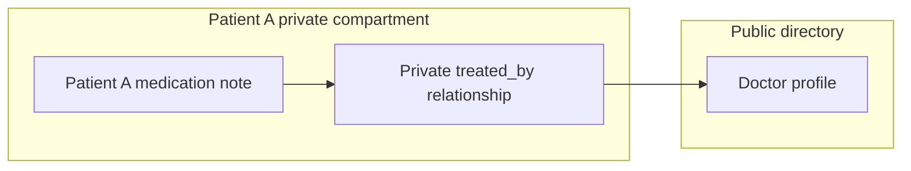

# Privacy-aware A-MEM: architecture proposal

Status: proposal only. No runtime changes are included.

Keep A-MEM's notes, semantic retrieval, linking, and evolution. Add a trusted
authorization layer, compartment-specific vector indexes, protected directed
relationships, and permission inheritance for generated information.

**1. What the current code does**

The inspected A-MEM implementation has one `memories` collection, alongside an
in-process `self.memories` dictionary. `MemoryNote` contains semantic metadata
and links, but no owner, requester, policy, or permission provenance.
`ChromaRetriever.search()` queries the collection without a metadata filter.
`read()`, the search variants, and linked-note expansion perform no access check.

Adding a note runs `process_memory()`, which retrieves neighbors and sends them
and the new content to an LLM. The model can suggest links and updates to existing
neighbors' tags and context. This is a separate information-flow path: even if
public retrieval hid private notes, private information could appear in a public
note's evolved metadata.

Two implementation issues also matter for this adaptation:

- Initialization attempts `client.reset()`, which is unsuitable for a shared
  persistent store. Consolidation also assumes the single collection.
- `find_related_memories()` returns search-result positions, and evolution uses
  those positions in dictionary insertion order. Those are different orderings;
  an update can reach the wrong note. Use stable note IDs throughout evolution.

The repository exposes `analyze_content()`, but `add_note()` does not call it.
The adaptation should specify when metadata generation occurs explicitly.

**2. What to carry over from Auto Research's online system**

The relevant local reference is
`../Shared-Memory-for-Multi-Agents-Qwen-3.2-27b/Auto Research/`, especially:

- `docs/online.md` and `docs/online-revision-20261018.md`: incremental ingestion,
  boundary snapshots, first-attempt preservation, and isolated repair/replay.
- `templates/memory_system/policy.py`: explicit authorization requests, isolation
  checks, denials before grants, and default denial.
- `templates/memory_system/policies/medical.json`: a clinical role requires a
  patient-specific relationship; a role alone does not authorize access.
- `templates/memory_system/schema.sql`: separate observations, memories,
  permissions, semantic relationships, and deletion tombstones.
- `online/authority.py`: candidate-derived permissions cannot become their own
  authority; reconstruct authority from trusted sources.

Use the same separation of trusted authority from adaptive memory. The initial
implementation need not reproduce the research orchestrator. A-MEM can remain
the memory engine; a later adapter can expose ingestion/query interfaces to the
online runner. In such experiments, adaptive candidates may improve indexing and
link selection, while authenticated policy and the authorization boundary stay
outside candidate control.

**3. Security boundary and assumptions**

The application authenticates the human requester and executing agent. It creates
a trusted request context; a user-supplied string claiming to be a doctor is not
authentication. An agent acts within both its own service permissions and the
delegating user's current permissions.

The memory service, authorization store, configured embedding/LLM processors,
and storage administrators are inside the chosen processing boundary. End users
and ordinary agents access a guarded API, not the vector database, Python
objects, filesystem, or raw memory dictionary. Separate collections on one server
do not protect data from that server's administrator or from a process with full
database access. Separate services, credentials, or encryption domains can be
added if those are required trust boundaries.

Use approved local processing for private note analysis, embeddings, and
evolution initially. Private queries also need approved processing. Merely
sending a private query to an external public search endpoint can disclose it.
Reusing one fixed embedding model across compartments is compatible with this
proposal; do not train shared model weights on private notes as part of ordinary
memory evolution.

**4. Extend notes with a policy reference**

An `authorized_users` list is a reasonable first ACL, but keep authoritative
grants in a policy store so revocation, groups, expiry, and delegation do not
require editing every embedding. Semantic tags remain ordinary model-generated
data. Security labels are structured fields that only trusted code can set.

Illustrative note fields, in addition to A-MEM's existing fields:

```json
{
  "id": "note_random_id",
  "tenant_id": "hospital_1",
  "owner_id": "patient_123",
  "compartment_id": "compartment_random_id",
  "visibility": "restricted",
  "policy_id": "policy_patient_123_medication",
  "policy_version": 4,
  "source_ids": ["observation_456"],
  "derived_from_ids": [],
  "status": "active"
}
```

The policy store holds authenticated grants such as principal/group, resource
scope, allowed actions, optional purpose, validity interval, issuer, and grant
provenance. An active care-team assignment can be a policy input. A semantic
`treated_by` link cannot itself grant access.

Keep read, write, delete, grant, and publication authority separate. An agent
that may read a patient's notes does not automatically get to publish them or
add another reader. Explicit denial, revocation, deletion, and expiry take
precedence over an otherwise matching allow.

Missing or malformed security metadata denies access. Existing unlabeled notes
go into an inaccessible migration/quarantine state until an authorized process
assigns policy. Nothing becomes public merely because classification failed.

Mixed public/private input remains private by default. Extracting an apparently
public doctor name from a patient encounter does not establish authority to
publish a doctor record. Prefer independently sourced public directory data.

**5. Partition indexes by stable access scope**

Use separate Chroma collections for approved public information and private
compartments. Initially, a compartment can correspond to a patient or an explicit
shared workspace. Use opaque collection identifiers if names themselves would
reveal private identities.

```text
public directory collection
patient A compartment collection
patient B compartment collection
optional explicitly shared workspace collections
```

These are separate indexes using the same embedding model and coordinate
system. There is no need to train a separate embedding model for every patient.
The relevant separation is which records are searched and who can reach them.

Avoid a single collection for everybody with a role such as `doctor`: one
doctor's access to patient A says nothing about patient B. Also avoid creating a
new collection for every combination of authorized users; membership changes
would continually rearrange storage. Stable compartments plus live policies
handle those changes more cleanly.

Compartments can contain notes with narrower policies, such as medication-only
delegation. The trusted service must constrain search to currently authorized
note IDs or an equivalent trusted filter before ranking. For an initial small
implementation, resolving allowed IDs from the policy store is straightforward;
optimize that lookup later without weakening its semantics.

Chroma supports metadata filters in `get()` and `query()` through `where`:
[Chroma metadata filtering](https://docs.trychroma.com/docs/querying-collections/metadata-filtering).
The current wrapper does not pass this argument and serializes lists/dicts to
JSON strings. Use typed scalar routing fields and a canonical policy store;
do not assume an `authorized_users` JSON string supports array membership
filtering. Pin and verify the actual Chroma version during implementation.

**6. Treat each relationship as protected data**

The patient/doctor example becomes:



The relationship record lives in the private compartment and contains its source
note ID, target note ID, predicate, policy reference, provenance, and lifecycle
state. It is not a backlink in the public doctor note.

A public reader sees the doctor profile only. An authorized patient reader can
see the private relationship and follow it to the public profile. The public
API exposes no patient IDs, incoming-edge counts, or indication that the private
relationship exists. Do not create reciprocal edges automatically.

There are two separate checks:

- Can the requester read this edge? That requires access to its relationship
  evidence and any endpoint information the edge reveals.
- Can the requester read the target? Following an edge never grants access to it.

For the first version, allow automatic linking within an equivalent policy scope
and from restricted notes to approved public notes. Disable automatic links
between distinct private scopes until an explicit shared policy is provided.
There is no requirement for the entire graph to be acyclic; same-scope cycles
can be useful. The restriction concerns visibility and information flow.

If authorized reverse lookup is needed later, implement it as a private,
policy-filtered query over edge records. It still does not alter the public node.

**7. Guard the complete ingestion and retrieval paths**

Ingestion:

```text
authenticated source + policy authority
  -> validate ownership, scope, and ingestion permission
  -> assign compartment and policy before model processing
  -> analyze using approved processors
  -> retrieve policy-compatible evolution context
  -> validate proposed tags, links, and updates
  -> commit canonical note, provenance, edges, and index state
```

Use a canonical store, such as SQLite for the prototype, for policies, notes,
edges, and provenance. Treat Chroma as a rebuildable search index. An index
failure must not publish an unprotected note; canonical state/version checks
must reject stale, missing, deleted, or incorrectly routed index records.

Retrieval:

```text
authenticated requester + agent + action + trusted query context
  -> resolve currently permitted compartments and note constraints
  -> search only permitted candidates
  -> recheck canonical note policy and lifecycle
  -> expand readable edges; authorize every target separately
  -> rank permitted results and build an authorized evidence packet
  -> generate answer using approved processing
  -> revalidate authorization before release
```

Recheck after search because index metadata or caches can be stale. If a policy
version changes during answer construction, discard affected evidence and
regenerate or withhold the response; removing citations cannot sanitize a
sentence already generated from revoked data.

Apply the same gateway to `read`, all search variants, raw related-memory
helpers, linked expansion, update/delete, consolidation, exports, and any future
graph API. Return copies or filtered views rather than mutable live note objects.
Do not provide an unguarded fallback when a requester is missing.

A user may see their own query text, but the answer must not confirm a protected
record exists. Keep public-facing counts, refusals, debug information, and error
messages independent of inaccessible records. Detailed access logs remain
restricted. Caches and retained model contexts must be scoped and revalidated;
a fresh database lookup does not erase private content from an old conversation.

**8. Make evolution respect the sources of every output**

The central rule is:

```text
readers(derived output) must be a subset of
the intersection of readers(all information used to produce it)
```

Apply this to content, summaries, keywords, tags, contexts, edges, and any new
embeddings. Enforce the underlying policy conjunction and provenance rather
than freezing a snapshot of current user membership: later revocations must
also restrict derived material.

This addresses a subtle failure in the existing evolution prompt. If one model
call sees a patient's medication and a public doctor profile, every generated
update from that call must conservatively inherit the private restrictions.
Checking only which neighbor an update targets is insufficient.

Initially:

- Evolve notes using context with equivalent policy scope.
- Allow private notes to incorporate public context while remaining private.
- Never update a public note using a prompt containing private material.
- Reject model-proposed policy changes, unauthorized target IDs, or broader
  visibility. The model suggests; trusted code authorizes and applies.
- If useful enrichment concerns a public note but relies on private context,
  store a private overlay referring to that public note.

A second public-only processing call can update public information using public
sources. Publication or declassification of private-derived information requires
separate explicit authority. A model's assertion that text is anonymized is not
that authority.

**9. Revocation and deletion are part of the design**

Revocation updates canonical permission state immediately. It invalidates
relevant caches, pending evidence packets, and dependent derived records; index
cleanup can follow because the release check already rejects stale access.
Derivatives retain source dependencies so permission changes remain enforceable.

Deletion tombstones the source and removes or invalidates its dependent notes,
edges, embeddings, and private overlays. Define retention for source payloads,
logs, snapshots, and backups before claiming deletion coverage. Historical replay
must overlay current restrictions, as the online system already describes.

Membership revocation normally changes policy, not collection placement. An
authorized change to a note's compartment or visibility needs a coordinated
migration; the old indexed copy must not remain accessible.

**10. Implementation sequence and acceptance criteria**

First implement a deterministic policy layer with an explicit request context,
canonical policies, default denial, and guarded CRUD. Then add compartment
routing and authorized-candidate filtering. Next implement protected edges and
evolution validation. Finally add durable ingestion/index recovery and an online
adapter if needed. Remove initialization-wide resets before shared use.

Use a fixed public doctor profile, two private patients, two assigned clinicians,
an unassigned clinician, and a scoped delegate as the initial fixture. Verify:

1. Public search/read reveals only approved public information.
2. Assigned clinician A can retrieve patient A but not patient B; a role alone
   grants neither patient's records.
3. Scoped delegation reveals only its permitted note types and expires correctly.
4. A private patient-to-doctor edge is traversable by authorized readers, while
   the public doctor response reveals no private edge or incoming count.
5. Direct IDs, raw helpers, linked expansion, exports, and mutable-object paths
   cannot bypass the gateway.
6. A private insertion/evolution leaves the public note, its metadata, and the
   public search result view unchanged. Test an adversarial evolution response
   proposing a public update as well as ordinary suggestions.
7. Revocation/deletion blocks stale vector hits, cached evidence, and derived
   outputs; a mid-request policy change prevents release of stale text.
8. Forged users, grants embedded in source content, malformed policy fields,
   cross-tenant links, and missing request contexts fail closed.
9. Index rebuild, restart, and consolidation preserve compartments and policies;
   interrupted indexing never widens access.

These establish functional authorization and information-flow behavior. They
do not establish protection against a compromised trusted server or eliminate
all timing side channels. Benchmark utility and privacy metrics can be added
after these deterministic boundaries pass; score improvements cannot substitute
for the boundaries themselves.
