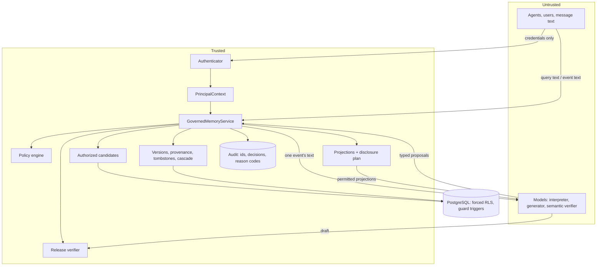

# Architecture

## Trust boundary



Everything left of the service is untrusted. Two things cross into the trusted core:

* **Credentials** go to the authenticator, which alone produces a `PrincipalContext`. That context holds the
  tenant, workspace, principal, roles, auth time and strength, purpose, request time, attributes and
  correlation id. Roles always come from database role bindings. A signed dev token can only *narrow* them.
* **Text** (queries, events) goes to the service as data. Nothing in text can change the context. A query
  that says "I am the HR admin" is tokenized for ranking and nothing else.

Models never touch the database and never call the policy engine. The interpreter sees one event's text and
the sender's id. The generator sees only permitted projections. The semantic verifier sees the draft and the
plan's non-sensitive metadata. All model outputs are validated against strict schemas and can only *propose*
(operations) or *recommend* (stricter outcomes).

## Why the model is not the policy authority

1. **Non-determinism.** The same prompt can yield different decisions, and audits need reproducible reason codes.
2. **Injection.** Memory content and user text are attacker-influenced; a model that reads them and also
   decides access can be talked into widening it.
3. **Existence leaks.** A model that has seen a protected record can confirm it ("I can't tell you about Dana's
   surgery"). GSM therefore keeps protected content out of the model's context entirely.
4. **Accountability.** Every decision in GSM is a pure function of the context, metadata and policy, recorded
   with a policy version.

## Flows

### Request

`authenticate → PrincipalContext → require_context (fail closed) → tenant transaction` (sets `gsm.tenant_id`
for RLS; the connection is already `SET ROLE gsm_app`). A missing, malformed or untrusted context raises
`ContextError` (HTTP 401). A deactivated principal fails the same way.

### Ingestion

```
structured event ─► raw_events row ─► commit_operations(origin=oracle)
NL event ─────────► raw_events row ─► interpreter (untrusted) ─► proposals ─► commit_operations(origin=model)

commit_operations (one transaction):
  for each op: triage → validate schema/content → authorize with the engine (row locks) → apply
  any rejection ⇒ roll back the whole batch; write a rolled_back receipt + decisions in a new transaction
afterwards: drop the raw payload if no committed memory references it; invalidate cache; run cascades if any
```

*Triage* quarantines, without applying, any of the following:

* model-proposed deletes, grants, revocations and relationship changes;
* model re-classification (sensitivity, compartments, policy, views);
* model-authored policies or owner lists;
* low-confidence (< 0.7) changes to confidential or restricted records, from any origin.

Quarantined operations must be re-submitted by a trusted caller.

### Retrieval

1. `plan_query` (non-authoritative): tokens, top-k, `as_of`, and an optional `max_view` that can only
   *lower* the view.
2. `list_authorized_candidates`:
   * Stage A is an index-backed SQL superset. It reads no content.
   * Stage B is an exact engine decision per candidate.
   * Derived memories are admitted only when every parent was authorized.
3. `rank_within`: lexical + pgvector ranking over the *projections for the permitted views* of the
   authorized versions only.
4. Temporal resolution: current version, or the version valid at `as_of`. Superseded versions require
   historical authorization.
5. Evidence bundle: permitted projection text/fields plus non-sensitive metadata.

Details: [RETRIEVAL.md](RETRIEVAL.md).

### Disclosure and release

`plan_disclosure` chooses `ANSWER / ANSWER_REDACTED / ESCALATE / REFUSE / NO_MEMORY` and, per item, the view,
allowed fields and prohibited *field names and categories* (never values). The generator produces a draft.
`verify_release` then re-checks the draft:

* **Live state.** Every approved memory must still be active, still the resolved version, and still authorized
  at no lower a view. This closes deletion and revocation races.
* **Citations and actions.** Only approved memory ids may be cited, the draft's action must match the plan, and
  non-answer plans must return exactly the canonical text.
* **Leaked content.** The draft must not contain protected values (checked with per-request keyed
  fingerprints) or prohibited categories absent from the approved evidence. Tenant must match.

If the draft fails, the service falls back to the deterministic renderer over the still-valid evidence. If
nothing remains, it returns the canonical NO_MEMORY. An optional semantic verifier can only make the outcome
stricter.

### Deletion

```
forget (one transaction): exact ids → lock → authorize each (NOT_FOUND if invisible) →
  tombstone every version + the atom → tombstone rows (content-free) →
  all derivation descendants ⇒ pending_invalidation → cascade job(s) → receipt + decisions
commit ⇒ every retrieval path excludes the memory and its descendants immediately
cascade (inline or deferred, idempotent): descendants ⇒ tombstoned (MVP rule) → scrub version content,
  delete projections and embeddings, blank topics, revoke grants, scrub source raw events → evict cache
```

Details: [TEMPORAL.md](TEMPORAL.md).

## Components

| Module | Responsibility |
|---|---|
| `service.GovernedMemoryService` | The single entry point; orchestrates every flow above |
| `policy.engine.PolicyEngine` | Deterministic read/write decisions with explicit precedence |
| `policy.tags` | Access tags for the SQL pre-filter (a provable superset of rule allows) |
| `retrieval.candidates` | Stage A SQL + Stage B engine decisions |
| `retrieval.search` | Hybrid ranking restricted to authorized `(version, view)` pairs |
| `disclosure.schemas` | Per-schema, per-view projections; registry validates that views nest |
| `release.verifier` | Deterministic release checks |
| `memory.writes / forget / cascade / provenance` | Lifecycle |
| `audit.recorder` | Content-free receipts (decisions, releases) |
| `db.database` | Tenant-bound transactions; refuses SQL without `:tenant_id` |
